# 🛡️ CrowdSec

Guia de instalação do **CrowdSec** em Docker para proteger um servidor com **Nginx Proxy Manager** e SSH: ele lê os logs, identifica ataques (força bruta, varredura, exploração de falhas conhecidas) e bloqueia o IP de origem no firewall do host.

---

## Conteúdo

- [Como funciona](#como-funciona)
- [Estrutura do repositório](#estrutura-do-repositório)
- [1. Subir o motor de detecção](#1-subir-o-motor-de-detecção)
- [2. Instalar o bouncer de firewall](#2-instalar-o-bouncer-de-firewall)
- [3. Testar o bloqueio](#3-testar-o-bloqueio)
- [Console da CrowdSec (opcional)](#console-da-crowdsec-opcional)
- [Comandos do dia a dia](#comandos-do-dia-a-dia)
- [Problemas comuns](#problemas-comuns)
- [Recursos adicionais](#recursos-adicionais)

---

## Como funciona

O CrowdSec é dividido em duas partes, e **as duas são necessárias**: só o motor não bloqueia nada.

| Parte | O que faz | Onde roda aqui |
|---|---|---|
| **Security Engine** | Lê os logs, aplica os cenários de ataque e grava as decisões (ex.: banir IP por 4 h) | Container `crowdsec` |
| **LAPI** | API local onde ficam as decisões | Dentro do container, em `127.0.0.1:8080` |
| **Bouncer** | Consulta a LAPI e aplica o bloqueio | Pacote no host, mexendo no iptables/nftables |
| **Blocklist da comunidade** | IPs maliciosos reportados por outros usuários, recebidos automaticamente | Vem pela internet, sem configuração |

---

## Estrutura do repositório

| Arquivo | Para que serve |
|---|---|
| `docker-compose.yml` | Container do CrowdSec com as coleções de Linux, SSH e Nginx Proxy Manager |
| `acquis.yaml` | Quais logs ler e de que tipo é cada um |
| `.env.example` | Caminho dos logs do NPM e fuso horário |
| `bouncer/iptables.yaml.local` | Configuração do bouncer para sistemas com iptables |
| `bouncer/nftables.yaml.local` | Configuração do bouncer para sistemas com nftables |

---

## 1. Subir o motor de detecção

```bash
git clone https://github.com/Jarderl/CrowdSec.git
cd CrowdSec
cp .env.example .env
nano .env          # ajuste NPM_LOGS para a pasta de logs do seu Nginx Proxy Manager
docker compose up -d
```

Confira se os logs estão sendo lidos (as linhas do NPM e do `auth.log` devem aparecer com contagem):

```bash
docker exec crowdsec cscli metrics show acquisition
```

---

## 2. Instalar o bouncer de firewall

### 2.1 Gerar a chave do bouncer

```bash
docker exec crowdsec cscli bouncers add firewall-bouncer
```

Copie a chave exibida: ela só aparece uma vez.

### 2.2 Instalar o pacote no host

```bash
curl -s https://install.crowdsec.net | sudo sh     # adiciona o repositório oficial
iptables -V                                        # descobre qual backend o sistema usa
```

- Se a saída mencionar **`nf_tables`**: `sudo apt install crowdsec-firewall-bouncer-nftables`
- Caso contrário: `sudo apt install crowdsec-firewall-bouncer-iptables`

### 2.3 Configurar

Copie o arquivo da variante instalada e cole a chave do passo 2.1:

```bash
sudo cp bouncer/nftables.yaml.local /etc/crowdsec/bouncers/crowdsec-firewall-bouncer.yaml.local   # ou iptables.yaml.local
sudo nano /etc/crowdsec/bouncers/crowdsec-firewall-bouncer.yaml.local
sudo systemctl restart crowdsec-firewall-bouncer
```

> ⚠️ **Por que o `DOCKER-USER` importa**: o tráfego para portas publicadas por containers (como o 80/443 do Nginx Proxy Manager) não passa pela cadeia `INPUT`. Sem `DOCKER-USER` (iptables) ou o hook `forward` (nftables), o CrowdSec detecta o ataque, mas o IP continua chegando ao proxy.

Confira se o bouncer se conectou (a coluna `Valid` deve estar marcada):

```bash
docker exec crowdsec cscli bouncers list
```

---

## 3. Testar o bloqueio

Use um IP de teste (nunca o seu):

```bash
docker exec crowdsec cscli decisions add --ip 203.0.113.50 --duration 5m --reason "teste"
docker exec crowdsec cscli decisions list
sudo journalctl -u crowdsec-firewall-bouncer -n 20      # deve registrar o IP adicionado
docker exec crowdsec cscli decisions delete --ip 203.0.113.50
```

---

## Console da CrowdSec (opcional)

O [console](https://app.crowdsec.net) mostra alertas, decisões e estatísticas no navegador. Crie a conta, copie a chave de inscrição e rode:

```bash
docker exec crowdsec cscli console enroll SUA_CHAVE
docker restart crowdsec
```

Depois aceite a inscrição no painel do console.

---

## Comandos do dia a dia

```bash
docker exec crowdsec cscli decisions list            # IPs bloqueados agora
docker exec crowdsec cscli alerts list               # Ataques detectados
docker exec crowdsec cscli decisions delete --ip X   # Desbloqueia um IP
docker exec crowdsec cscli metrics                   # Logs lidos, parsers e cenários disparados
docker exec crowdsec cscli hub update                # Atualiza o índice do hub
docker exec crowdsec cscli hub upgrade               # Atualiza coleções, parsers e cenários
docker exec crowdsec cscli collections list          # Coleções instaladas
```

---

## Problemas comuns

- **Bloqueei a mim mesmo**: pelo console do provedor (ou outra rede), rode `cscli decisions delete --ip SEU_IP`. Faixas de IP privadas (192.168.x, 10.x) já vêm na lista de exceções.
- **`cscli metrics` não mostra os logs do NPM**: o caminho em `NPM_LOGS` não está certo; confira se a pasta contém arquivos `proxy-host-*_access.log`.
- **`auth.log` não existe**: o sistema registra o SSH só no journald. Instale o `rsyslog` (`sudo apt install rsyslog`) ou remova esse bloco do `acquis.yaml`.
- **Porta 8080 ocupada**: troque `LAPI_PORT` no `.env` e ajuste o `api_url` do bouncer.
- **Alertas aparecem, mas o IP continua acessando o site**: falta `DOCKER-USER` (iptables) ou `forward` (nftables) na configuração do bouncer.

---

## Recursos adicionais

- [Documentação do CrowdSec](https://docs.crowdsec.net/)
- [Instalação em Docker](https://docs.crowdsec.net/u/getting_started/installation/docker/)
- [Bouncer de firewall](https://docs.crowdsec.net/u/bouncers/firewall/)
- [Coleção Nginx Proxy Manager no hub](https://app.crowdsec.net/hub/author/crowdsecurity/collections/nginx-proxy-manager)
